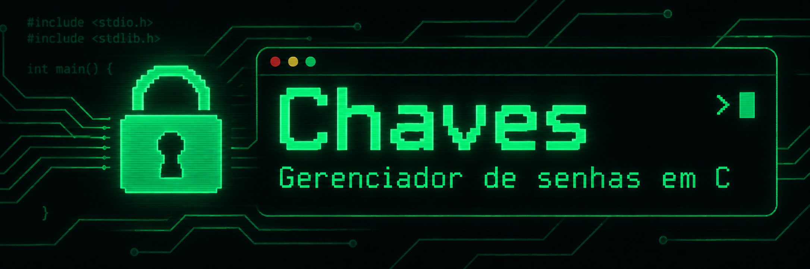

# Chaves
Gerenciador de login e senhas em C que roda no terminal. Você cadastra, consulta, atualiza e exclui credenciais (aplicativo, login, senha e observação), e tudo fica guardado em um arquivo binário local. O acesso ao programa é protegido por uma senha mestra.

> Projeto de estudo, feito para praticar C: structs, arquivos binários, funções e organização de código. **Não use para guardar senhas reais.** Veja [Limitações conhecidas](#limitações-conhecidas).


## Funcionalidades:
- Senha mestra para entrar no programa (comparada por hash, não em texto puro)
- Salvar uma nova chave (aplicativo, login, senha e observação)
- Visualizar todas as chaves cadastradas
- Atualizar uma chave existente
- Excluir uma chave individualmente ou todas de uma vez (com confirmação digitando `excluirtudo`)
- Dados salvos em arquivo binário e carregados ao iniciar
- Limite de 100 chaves


## Tecnologias:
- Linguagem C
- Biblioteca padrão (`stdio.h`, `string.h`) e `windows.h`


## Como executar:
Você precisa de um compilador C, como o [GCC (MinGW)](https://www.mingw-w64.org/), no Windows.


```bash
# 1. Clone o repositório
git clone https://github.com/Peressjj/Chaves-de-acesso-em-C.git

# 2. Entre na pasta
cd Chaves-de-acesso-em-C

# 3. Compile
gcc teste222.c -o chaves.exe

# 4. Execute
./chaves.exe
```


## Como usar:
Ao abrir, o programa pede a senha mestra e depois mostra o menu:

```
(1) - Salvar chave
(2) - Visualizar chave
(3) - Atualizar chave
(4) - Excluir chave
(0) - Sair
```

Digite o número da opção e siga as instruções na tela. Os dados são gravados em `teste222.bin`, criado automaticamente na primeira chave salva.


## Como funciona:
- Cada chave é uma `struct` com os campos `app`, `login`, `senha` e `obs`.
- As chaves ficam em um array de tamanho fixo (`MAX = 100`) e são gravadas no arquivo com `fwrite`, lidas com `fread`.
- A senha mestra não aparece no código em texto puro: só o hash dela (algoritmo djb2) fica guardado, e a senha digitada é comparada com ele.

## Limitações conhecidas:
Este é um projeto de aprendizado, então algumas coisas ainda não são seguras:

- Os dados ficam **sem criptografia** no arquivo `.bin`; qualquer pessoa com acesso ao arquivo consegue lê-los.
- O hash djb2 é simples e rápido, feito para outros fins, e **não é adequado para proteger senhas**.
- A senha mestra está fixa no código e só muda recompilando.
- A senha aparece na tela enquanto é digitada.
- Funciona apenas no Windows (usa `windows.h`).

## Próximos passos:
- Criptografar os dados salvos
- Esconder a senha ao digitar
- Permitir trocar a senha mestra sem recompilar
- Validar melhor as entradas do usuário

## Autor:
Feito por [João Peres](https://github.com/Peressjj)

**email:** joaovitorperes06@gmail.com

**Instagram:** @peress.jj